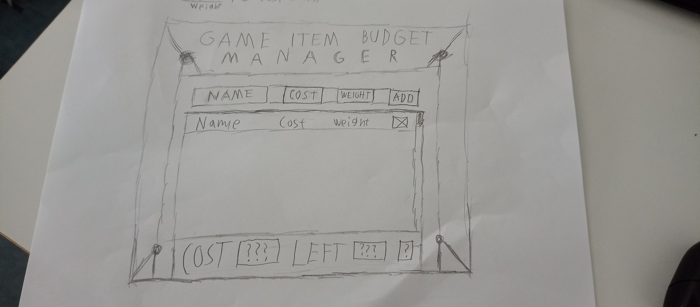

Project README.md template from: https://github.com/juhkast/laurea-web-development-1/blob/main/Github%20ohjeita/readme-template.md

# GIB (Game Item Budget) Manager

**Tekijä: Oskari Elomaa** 

## Projektisuunnitelma

### Projektin idea

Projektin idea on luoda lista tavaroista budjitointia varten ja suositella turhempien tavaroiden poistamista mainitusta listasta jos on yli budjetin.

Tämä on suuniteltu videopeli pelaajille, jotka huluavata helpomman ajan hallita heidän virtuaalista budjettia.

### Suunnitellut toiminnot

- Käyttäjä voi lisätä asioita listaan ja antaa niille kaksi arvoa: Hinta ja tärkeys.
- Käyttäjä voi muokata tavaroita listassa, eli vaihtaa niiden hintaa ja tärkeyttä.
- Käyttäjä voi poistaa asioita listasta.
- Käyttäjä voi kirjoitaa budjetin.
- Nappi, mikä näyttää toisen listan.
- Jos sivusto löyttää ainakin yhden asian listasta ja budjetin, se kirjoittaa:
  - Kaikkien asioiden yhteinen hinta listasta.
  - Jäljellä oleva raha/hinta laskusta.
  - Toiseen listaan asioita, mitä suosittelee mitä voisi poistaa ensimäisestä listasta.
- Käyttäjä voi tallentaa nykyisen listan ja ladata sen myöhemin (esim. Eri sivussa. Rajattu ainoastaan yhteen tallenteeseen.)

### Rautalankamalli / luonnos

Vanha piiretty rautalankamalli

## Verkkolinkit

- **Julkaistu sovellus:** [Github Page Linkki](https://marlins3rdgituser.github.io/Frontend-Web-Development_Project-1/)
- **GitHub-repositorio:** [... Sinä olet jo siinä.](https://github.com/Marlins3rdGitUser/Frontend-Web-Development_Project-1/tree/main)
- **Projektin videoesittely:** [Youtube Linkki](https://youtu.be/THj1jxm4ID0)
  
## Tietoja sovelluksesta

**GIB (Game Item Budget) Manager** on verkkosovellus, minkä tarkoitus on antaa käyttäjän luoda helpo lista videopeli tavaroiden hinnoista ja tärkeydestä, sekä omasta videopeli budjettista.

Sitten verkosovellus käyttää näitä arvoja tulostaakseen jäljellä oleva videopeli budjetti ja toisen listan mitä jättäisi pois listasta käyttäen tavaroiden tärkeyttä ja hintaa muokatavalla rationilla.

## Teknologiat

- HTML – Sivun rakenne
- CSS – Ulkoasu ja asettelu
- JavaScript – Toiminnallisuus ja DOM-skriptaus
- LocalStorage - Tallentaakseen & Lataakseen Listan

## Sovelluksen käyttö

Verkkosovelluksen pääkäyttö:

1. Avaa julkaistu verkosovellus yllä olevasta linkistä.
2. Lisää tavaran nimi, hinta ja tärkeys (paino) annetuille kentille ja paina "Add"
2-1. Tee tämä niin monta kertaa kun haluat, kunnes riittää.
3. Lisää budjetti "Budget" alueelle.
4. Jos teit ylemmät oikein, niin "Total Cost" ja "Remaining" alueilla tulisi olla laskujen tulokset.
5. Jos "Remaining" alueen arvo on negatiivinen, niin voi painaa kysymys merkki nappia näyttääkseen toisen listan, missä on lista tavaroit joita voisi poistaa.

Verkosovelluksesta löytyy myös "Save current list" ja "Load saved list" nappit, mikä antaa tallentaa ja ladata listat.

1. Tee ylhäällä olevat askeleet.
2. Paina "Save current list" kun olet valmis.
3. Sulje verkkosovellus ja avaa se uudelleen.
4. Paina "Load saved list" ja nytten lista on tullut takaisin.

## Sovelluksen käynnistäminen paikallisesti

1. Kloonaa tai lataa tämä repositorio omalle koneellesi.
2. Avaa projektikansio.
3. Avaa `index.html` selaimessa.

## Kuvakaappaukset

[Kuvakaapaus1](README_Images/ProjectFunctionalScreenshot1.png)
[Kuvakaapaus2](README_Images/ProjectFunctionalScreenshot2.png)

## Tunnetut virheet / puutteet

**Ei tunnettuja virheitä.**

## Oma arvio ja oppimisen reflektointi

- Missä onnistuin?
  - Toimintojen luomisessa.

- Mikä oli haastavaa?
  - Tyylien luominen ja oikean näkymän saaminen.

- Mitä parantaisin, jos aikaa olisi enemmän?
  - Yliaikaa oli otettu. Ei voi tehdä enempää.

- Mitä opin HTML:stä, CSS:stä, JavaScriptistä ja DOM-skriptauksesta?
  - Että jotkut asiat ovat todella yksinkertaisia tai TODELLA monimutkaisia. Riippuu kontekstista.

- Mikä jäi epäselväksi tai mistä haluaisin oppia lisää?
  - None

- Oma arvio projektista: **07/10 pistettä**
  - Syy: Myöhäinen palautus.
  - Syy2: Huono näkymä/tyyli.

## Lähteet ja kiitokset

- [Kursin workshop materiaali](https://github.com/juhkast/laurea-web-development-1/tree/main)
- [Omat aikasemmat kursi workshop vastaukset](https://github.com/Marlins3rdGitUser/Frontend-Web-Development)
- Autofill tai jotain mikä näytti yhden vastauksista...

## Lisenssi

Ei ole aktiivista lisenssiä.
